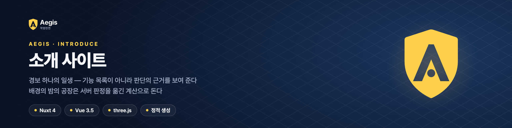

<p align="center"></p>

<p align="center">
  
  
  
  
</p>

<p align="center"><sub><a href="https://github.com/Scube-Platform/Interface">Interface</a> 서버 &nbsp;·&nbsp; <a href="https://github.com/Scube-Platform/Dashboard">Dashboard</a> 관제 &nbsp;·&nbsp; <a href="https://github.com/Scube-Platform/Watch">Watch</a> 워치 · 폰 &nbsp;·&nbsp; <a href="https://github.com/Scube-Platform/iOS">iOS</a> 아이폰 &nbsp;·&nbsp; <a href="https://github.com/Scube-Platform/Deploy">Deploy</a> 배포 &nbsp;·&nbsp; <b>Introduce</b> 소개 &nbsp;·&nbsp; <a href="https://github.com/Scube-Platform/Brand">Brand</a> 로고</sub></p>

# Aegis — 소개 사이트

AI 센서융합 작업안전 시스템 Aegis 의 소개(랜딩) 페이지.
기능 목록이 아니라 **판단의 근거**를 보여 준다 — 무엇을 거르고, 왜 그 순서로 판정하고, 아직 무엇이 없는지.

페이지 전체가 **경보 하나의 일생**(신호 → 마감)이다. 스크롤 진행이 곧 경보의 상태이고, 그 상태가 지면 색과
배경 3D(시드 현장 「시범 공장」의 밤)를 함께 정한다. 배경에서 지게차가 작업자에게 다가가는 장면은
서버 판정을 옮긴 계산으로 돌아간다 — 등급이 오르는 순간과 지게차가 서는 자리는 손으로 정한 값이 아니다.

**Nuxt 4 · Vue 3.5 · TypeScript · three.js · 정적 생성.**
서버(Aegis) · 관제 화면(AegisDashboard) · 워치(AegisWatch) · 폰(AegisPhone)과는 독립된 패키지다.

- 시각 세계 · 토큰 · 컴포넌트 규칙: [`DESIGN.md`](./DESIGN.md)
- 공개 저장소다 — 넣지 않는 것(실제 현장 이름 · 사업명 · 실측 수치 · 내부 주소): [`DESIGN.md` 9장](./DESIGN.md#9-공개-사이트)
- 제품 사실의 원본: 서버 · 워치 저장소의 코드와 인수인계 위키(`HANDOVER.html`) — 이 페이지는 그것을 옮길 뿐이다

## 실행

```bash
pnpm install

pnpm dev          # 개발 서버 (http://127.0.0.1:3140)
pnpm build        # 정적 생성 → .output/public
pnpm preview      # .output/public 을 정적 서버로 미리보기 (같은 3140)
pnpm typecheck    # vue-tsc
```

> `.output/public/index.html` 을 더블클릭해 열지 않는다. 스크립트가 `/_nuxt/...` 절대 경로라 `file://` 에서는 전부 깨진다.
> `pnpm preview` 로 연다.

## 구조

```
app/
  app.vue                         구성만 한다 — 구간 순서
  components/
    stations/*.vue                구간 하나 = 파일 하나. 각 구간이 자기 카피를 소유한다
    collision/CollisionPlayground.vue   충돌 판정기 — 이 페이지에서 유일하게 상태가 있는 화면
    flow/FlowScene.vue            스크롤 엔진 — 레일 · 캔버스 가시성 · 등장 모션 · 3D 단계
    site/                         헤더 · 푸터 · 로고 · 아이콘
  lib/
    stations.ts                   구간 목록 (레일 눈금과 3D 단계가 여기서 나온다)
    collision.ts                  ★ 충돌 판정 — 서버 risk 컨텍스트 이식
    story.ts                      ★ 배경 장면의 시뮬레이션 — collision.ts 로 0.05초마다 판정
    site.ts                       시드 현장 대장 (구역 · 차량 · 사람)
    factory.ts                    공장 몸체 — 바닥 · 벽 · 조명 · 랙 · 설비 · 작업자 · 지게차 (관제 화면 3D 모형을 옮김)
    site-scene.ts                 ★ 배경 3D "밤의 시범 공장" — 조명 · 카메라 · 경보 이야기
  assets/css/main.css             토큰 · 밴드 · 컴포넌트 전부
  assets/fonts/                   Pretendard (OFL, 자가호스팅 — 외부 CDN 을 부르지 않는다)
```

## 코드와 어긋나면 안 되는 곳

소개 페이지가 코드와 다른 말을 하면 안 된다. 원본이 바뀌면 여기도 함께 고친다.

| 이 저장소 | 원본 |
|---|---|
| `app/lib/collision.ts` 기준값 · 필터 순서 · 위험 반경 · 문장 | 서버 `risk/domain/CollisionRiskPolicy.java` · `CollisionAssessment.java` · `risk/application/service/CollisionRiskService.java` · `registry/domain/Vehicle.java` · `alarm/domain/WarningTemplates.java` · `RapidWarning.java` · `AlarmLevel.java` · `ControlPolicy.java` |
| `app/lib/site.ts` 구역 꼭짓점 · 차량 제원 · 작업자 (현장 이름만 공개용 가상 이름) | 서버 `platform/config/DevDataSeeder.java` |
| `Ack.vue` 진동 파형 | 워치 `wear/…/alarm/WatchAlarmPresenter.kt` `vibrate()` |
| `Ingest.vue` · `Vitals.vue` · `Measure.vue` 규칙 · 정량목표 · 실측 단계 · 시험 수 (실측 수치는 싣지 않음) | 서버 README · 인수인계 위키 2 · 5.2 · 12장 |
| `Later.vue` 못 하는 것 · 배경의 빈 고리 | 인수인계 위키 1장 「지금 위험한 것」 · 14장 「남은 일」 |
| 등급색 `--lv-*` · 구역색 `ZONE_COLOR` | 관제 화면 `src/lib/levels.ts` |
| `factory.ts` 작업자 · 지게차 · 프레스 · 탱크 · 피트 · 출하장 모형 | 관제 화면 `src/components/site3d/SiteScene.tsx` |
| 로고 도형 | `brand/aegis/aegis-mark-reverse.svg` |

시연용 값(판정기 입력 · 수집 결과 예시 · 운전자 운행 세션)은 그 값이 있는 자리에 시연용이라고 적어 두었다.
배경 장면의 걸음 · 제동 · 반응 시간 가정은 RAISED 구간 아래에 적었다.

## 배포

서버 런타임이 없는 정적 사이트다. `pnpm build` 결과(`.output/public`)를 nginx 같은 정적 서버에 그대로 올린다.

- **GitHub Pages** — <https://scube-platform.github.io/Introduce/>. main 에 들어오면 `.github/workflows/pages.yml` 이
  타입 검사 → `NUXT_APP_BASE_URL=/Introduce/` 정적 생성 → 배포까지 한다. 손으로 다시 올릴 때는 Actions 의 Pages 를 직접 실행한다.
- **서브경로에 올릴 때**는 `NUXT_APP_BASE_URL=/경로/ pnpm build` (끝의 `/` 가 없으면 `/_nuxt/...` 가 전부 404 난다).
- **관제 화면 링크**는 기본으로 그리지 않는다. 사내 주소를 소스에 박아 두지 않으려고, 빌드할 때
  `NUXT_PUBLIC_CONSOLE_URL=<관제 화면 주소>` 로 넣으면 헤더 · 닫는 말에 링크가 생긴다.
